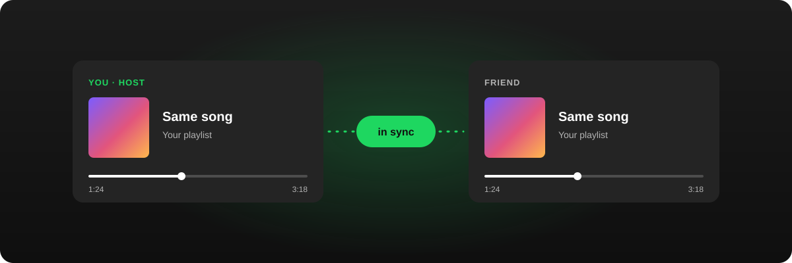
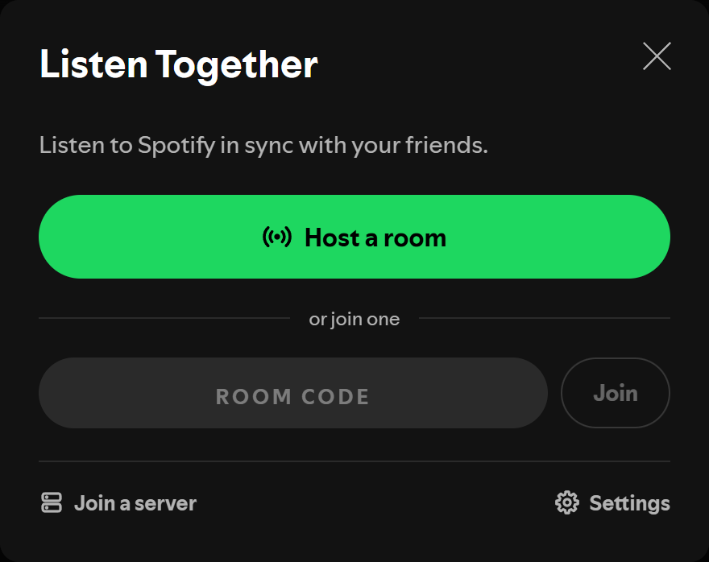
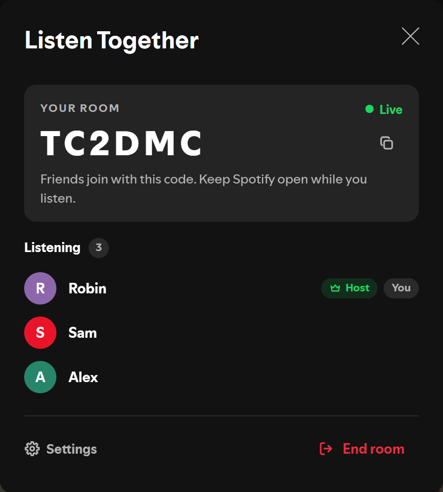
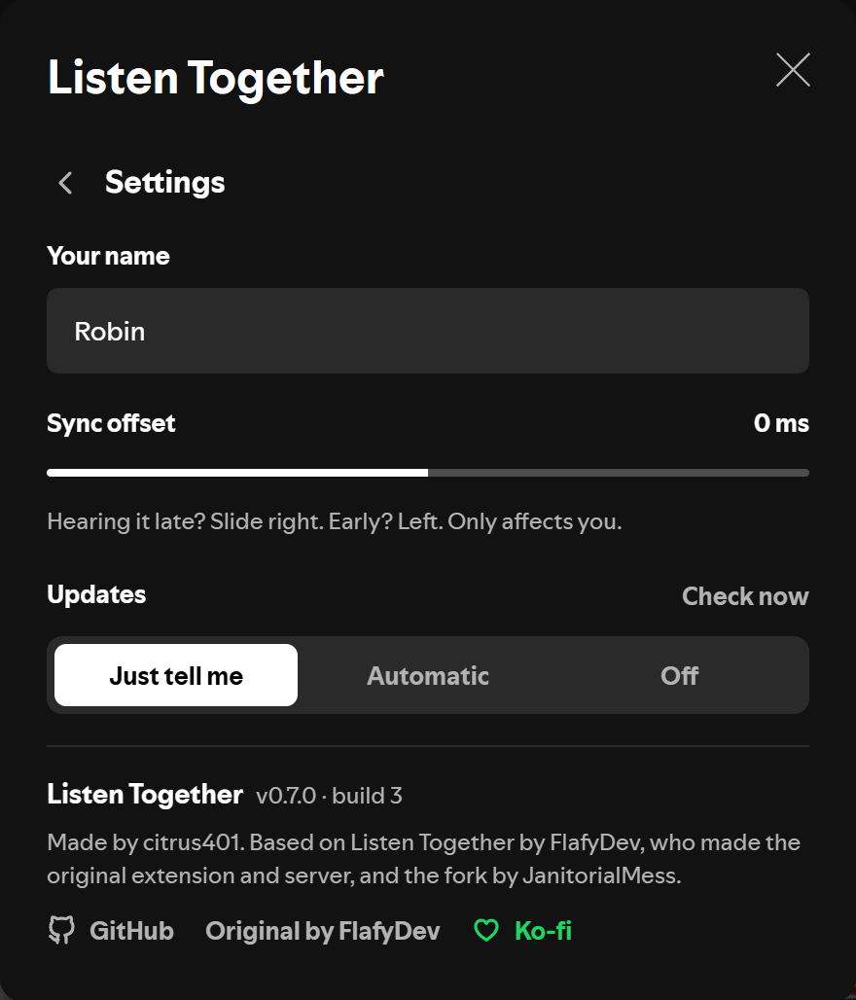
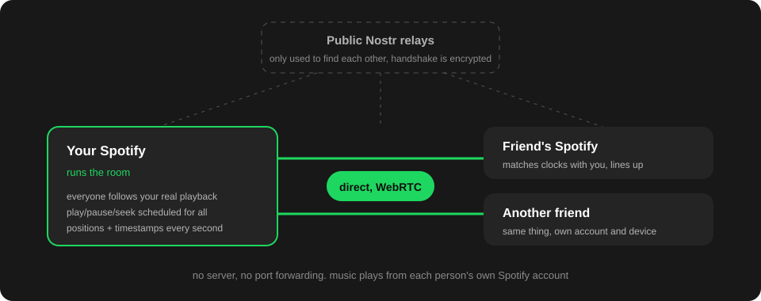

<p align="center">
  
</p>

<h1 align="center">Listen Together</h1>

<p align="center">
  <b>Listen to Spotify with your friends, actually in sync.</b><br>
  A <a href="https://spicetify.app/">Spicetify</a> extension, and an upgrade over Spotify Jam.
</p>

<p align="center">
  
  
  
  <a href="https://ko-fi.com/citrus401"></a>
</p>

<p align="center">
  Based on <a href="https://github.com/FlafyDev/spotify-listen-together">Listen Together by FlafyDev</a>. See <a href="#credits">credits</a>.
</p>

---

Listen Together keeps everyone's Spotify on the same song at the same moment. Everyone listens on their own
account and their own device, the extension handles the timing.

- **Host a room in one click.** Friends join with a 6 letter code. No server, no port forwarding.
- **Tight sync.** Play, pause and seek happen at the same moment for everyone, and small drift gets fixed quietly.
- **Songs change live.** No pause and restart between songs, and crossfade works.
- **Playlists and albums carry over**, so skip, previous and the playlist view work like normal.
- **Anything the host does carries over**: media keys, the mini player, controlling Spotify from your phone, the sleep timer.
- **Sync offset** per person, for Bluetooth headphones and other delay Spotify can't see.
- **Updates itself** from this repo. It can just tell you, update automatically, or stay off.

## Download

You need the Spotify app from [spotify.com](https://www.spotify.com/download/) (the Microsoft Store version doesn't
work with Spicetify) and [Spicetify](https://spicetify.app/docs/getting-started/installation).

### Quick installation (Windows)

Open **Windows PowerShell** (not as administrator) and run these one at a time.

1. Install Spicetify, if you don't have it yet:

   ```powershell
   iwr -useb https://raw.githubusercontent.com/spicetify/cli/main/install.ps1 | iex
   ```

2. Install Listen Together:

   ```powershell
   iwr -useb https://raw.githubusercontent.com/citrus401/spotify-listen-together-2.0/build/listenTogether.js -OutFile "$env:LOCALAPPDATA\spicetify\Extensions\listenTogether.js"; spicetify config extensions listenTogether.js; spicetify apply
   ```

   If Spicetify tells you to run `spicetify backup apply`, run that.

### Manual installation

1. Download and install [Spicetify](https://spicetify.app/docs/getting-started/installation).
2. Download [listenTogether.js](https://raw.githubusercontent.com/citrus401/spotify-listen-together-2.0/build/listenTogether.js) (right click, save as).
3. Put `listenTogether.js` in Spicetify's `Extensions` folder (`%LOCALAPPDATA%\spicetify\Extensions` on a default install).
4. Run `spicetify config extensions listenTogether.js` and `spicetify apply`.

You only install it once. New versions come in through the app, see [Updates](#updates).

> When Spotify updates itself it removes Spicetify. Run `spicetify backup apply` again and everything is back.

## Usage

Press the **Listen Together** button in the top bar to open the panel.

<p align="center">
  
</p>

### Hosting a room

Press **Host a room**. The panel shows your room's 6 letter code with a copy button, send it to your friends.
Your name and picture come from your Spotify profile, nothing to fill in.

Your Spotify is the room, so keep it open while you listen. Everyone follows your playback.

<p align="center">
  
</p>

While you're in a room, a chip in the player bar shows the code and who's listening. Click it to open the panel.

<p align="center">
  
</p>

### Joining a room

Type the code into the box under **Host a room** and press **Join**.

### Playing, seeking, and pausing songs

Only hosts can change, seek and pause songs. Whoever made the room is always a host. Anyone else can press
**Request host**, and the room's owner gets a popup to allow it. If you're not a host and play a song, it's sent
to the hosts as a request.

For hosts everything works like normal Spotify: playlists, albums, the queue, shuffle, repeat, crossfade, skip,
previous, media keys, and controlling Spotify from your phone.

### Settings

The cogwheel in the panel opens settings:

- **Your name** as others see it.
- **Sync offset**: if you hear the music a bit later or earlier than everyone else (usually Bluetooth headphones),
  slide right if you're hearing it late, left if early. It only changes it for you.
- **Updates**, see below.
- Version, credits and links.

<p align="center">
  
</p>

### Updates

Every push to this repo is built automatically, and the extension checks for new builds when Spotify starts and
every few hours. In settings, **Updates** switches between:

- **Just tell me** (default): a popup asks before updating.
- **Automatic**: it downloads quietly and uses the new version next time Spotify starts.
- **Off**: it never checks.

**Check now** checks right away.

### Leaving a room

Press **Leave**, or **End room** if it's yours. If the host leaves, the room closes for everyone.

## Using a server instead

Rooms connect people's Spotify apps directly. Some networks (some mobile hotspots and strict routers) block direct
connections. If joining a room says it couldn't connect directly, use a server: everyone opens **Join a server**
at the bottom of the panel and enters its address. Servers use the older sync method, so rooms are the better option when they work.

The server is in [`server/`](server/). To run it yourself you need [Node.js](https://nodejs.org/):

```powershell
cd server
npx yarn
npx yarn build
$env:HOST_PASSWORD = "pick-a-password"; npx yarn start
```

It runs on port 3000 (change it with `PORT`). Hosts get controls with **Request host** and that password.

Or host it on Render:

[](https://render.com/deploy?repo=https://github.com/citrus401/spotify-listen-together-2.0)

## How it works

<p align="center">
  
</p>

- The host's Spotify runs the room. Friends connect straight to it over WebRTC.
- Public [Nostr](https://nostr.com/) relays are only used for the two sides to find each other. The handshake is
  encrypted with the room code, and nothing else goes through them.
- Friends match their clock with the host's, and the host sends its position with a timestamp every second, so
  network delay doesn't affect the sync.
- Play, pause and seek get scheduled for a moment just past everyone's network delay, so everyone does them at the
  same time.

## Todo

- A relay fallback for networks that block direct connections, so servers aren't needed there.
- Bring the newer sync to servers.
- A listing on the Spicetify Marketplace.

## Credits

Listen Together was created by **[FlafyDev](https://github.com/FlafyDev)**:
[the original extension](https://github.com/FlafyDev/spotify-listen-together) and
[server](https://github.com/FlafyDev/spotify-listen-together-server). The idea, the original design and a lot of the
code are theirs.

This version builds on **[JanitorialMess](https://github.com/JanitorialMess)'s fork**
([extension](https://github.com/JanitorialMess/spotify-listen-together),
[server](https://github.com/JanitorialMess/spotify-listen-together-server)), which added queue sync and cleaned up a
lot of the code. Both histories are kept in this repo.

Peer to peer rooms use [Trystero](https://github.com/dmotz/trystero). The icon is from the original project.

Listen Together 2.0 (rooms, the new sync, Spotify 1.3 support and the updater) is by
**[citrus401](https://github.com/citrus401)**.

## Support

If Listen Together made your listening sessions better, you can [buy me a coffee on Ko-fi](https://ko-fi.com/citrus401).

## License

[MIT](LICENSE). The original copyright stays with FlafyDev, the changes are mine.
